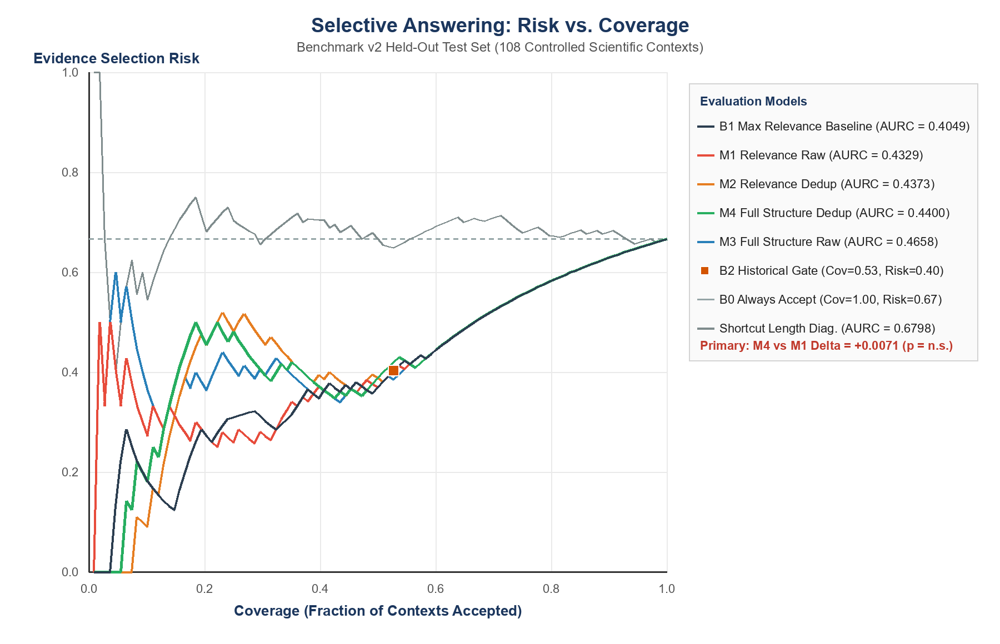

# AI Research Copilot: Evaluating Duplicate-Aware Evidence Aggregation for Selective Scientific Question Answering

[](https://www.python.org/)
[](LICENSE)
[](tests/)
[](docs/teacher_submission/REPRODUCTION_README.md)

---

## Academic Project & Team Information

This repository hosts both the interactive **AI Research Copilot** software platform and the formal empirical research study: **"Evaluating Duplicate-Aware Evidence Aggregation for Selective Scientific Question Answering"**.

- **Academic Project Team:**
  - **Akanksha Jaiswal** (230905106) — Computer Science and Engineering (CSE Core)
  - **Mohd. Uzair Qureshi** (220905158) — Computer Science and Engineering (CSE Core)
  - **Soham Pawar** (230905312) — Computer Science and Engineering (CSE Core)
- **Project Supervisor / Guide:** **Dr. Adarsh Rag**
- **Department:** Department of Computer Science and Engineering
- **Minor Specialization:** Artificial Intelligence / Machine Learning (Computational Intelligence)
- **Date of Submission:** 15 November 2026
- **Original Software Architecture & Maintainer:** Soham Pawar ([@soh4mpawar](https://github.com/soh4mpawar))

---

## 1. System Architecture vs. Evaluated Scientific Scope

To ensure scientific clarity, this repository strictly distinguishes between the interactive user-facing application and the isolated evidence-sufficiency gating experiment:

```
┌────────────────────────────────────────────────────────────────────────────────────────┐
│                                 AI RESEARCH COPILOT                                    │
│                                                                                        │
│   ┌──────────────────────────┐    ┌──────────────────────────┐    ┌────────────────┐  │
│   │ Hybrid Retrieval Engine  │ ──►│ Cross-Encoder Reranker   │ ──►│ GraphRAG 1-Hop │  │
│   │ (Dense Nomic + BM25s)    │    │ (BAAI/bge-reranker-base) │    │ Citation Graph │  │
│   └──────────────────────────┘    └──────────────────────────┘    └────────────────┘  │
│                                                 │                                      │
│                                                 ▼                                      │
│                                   ┌──────────────────────────┐                         │
│                                   │ Selective Evidence Gate  │ ◄── EVALUATED RESEARCH  │
│                                   │ (Models M1–M4, B0–B2)    │     SCOPE (THIS STUDY)  │
│                                   └──────────────────────────┘                         │
│                                      │                     │                           │
│                                [Sufficient]          [Insufficient]                    │
│                                      │                     │                           │
│                                      ▼                     ▼                           │
│                                 Downstream            Abstain /                        │
│                               Answer Generation    Prompt for Retrieval                │
└────────────────────────────────────────────────────────────────────────────────────────┘
```

1. **Interactive Research Application:** An end-to-end literature assistant with ChromaDB dense vector indexing (`nomic-ai/nomic-embed-text-v1.5`), BM25 sparse keyword retrieval (`bm25s`), cross-encoder neural reranking (`BAAI/bge-reranker-base`), in-memory NetworkX citation network exploration with interactive PyVis rendering, and a multi-page Streamlit frontend.
2. **Evaluated Scientific Scope (Evidence-Sufficiency Gating):** The empirical benchmark strictly isolates and evaluates **pre-generation evidence-sufficiency gating**. It measures whether retrieved passages provide sufficient evidence to support an answer, evaluating models on acceptance coverage and evidence-selection risk.
3. **Explicit Boundary:** **This study did not evaluate downstream generated-answer correctness or hallucination reduction.** All selective gating models are evaluated on frozen context records without downstream generative LLM synthesis.

---

## 2. Research Problem & Mathematical Formulation

### The Relevance Illusion
In retrieval-augmented scientific question answering, cross-encoder rerankers frequently assign high relevance scores ($>0.90$) to passages that discuss the query topic but omit the exact parameter, mathematical formulation, or experimental condition required to derive an answer. Unconditional RAG systems hallucinate when presented with these relevant-but-insufficient contexts. Furthermore, near-duplicate or redundant passages from the same paper can artificially inflate raw relevance sums while crowding out complementary evidence.

### Exact Within-Paper Deduplication
We formalize exact within-paper deduplication over a passage multiset $C = (p_1, \dots, p_K)$. Two passages $p_i$ and $p_j$ are equivalent ($p_i \equiv p_j$) if and only if:
$$\text{normalize\_whitespace}(p_i.\text{text}) = \text{normalize\_whitespace}(p_j.\text{text}) \quad \wedge \quad p_i.\text{paper\_id} = p_j.\text{paper\_id}$$

For each duplicate equivalence class, the deduplication engine deterministically retains the canonical representative with the highest cross-encoder relevance score:
$$p^* = \arg\max_{p \in [p_i]} p.s$$
yielding the deduplicated context $C_{\text{dedup}} = (p'_1, \dots, p'_{K'})$ where $K' \le K$.

### 2×2 Factorial Experimental Design
To determine whether structural features and deduplication improve evidence-sufficiency decisions over relevance alone, we evaluate four gating models:

| Model | Feature Space | Dimensions | Deduplication Applied? | Features Included |
| :--- | :---: | :---: | :---: | :--- |
| **M1 (Relevance Raw)** | Relevance | 4D | No | Top-1 score, Top-2 score, Mean score, Score spread ($s_{(1)} - s_{(K)}$) |
| **M2 (Relevance Dedup)** | Relevance | 4D | **Yes** | Same 4 relevance features computed on $C_{\text{dedup}}$ |
| **M3 (Full Structure Raw)** | Relevance + Structure | 8D | No | 4D Relevance + Top-paper second score, Other-paper max score, Section entropy, Section mean score |
| **M4 (Full Structure Dedup)**| Relevance + Structure | 8D | **Yes** | Full 8D vector computed on $C_{\text{dedup}}$ |

All models are parameterized via Standardized Logistic Regression:
$$P(\text{Sufficient} \mid C) = \sigma\left(\mathbf{w}^T \mathbf{z} + b\right), \quad \mathbf{z} = \text{StandardScaler}(\mathbf{x})$$

### Reference Baselines
- **B0 (Always Accept):** Unconditional acceptance baseline ($\hat{y} = 1$). Discrete AURC equals the insufficient-label prevalence $E/N$.
- **B1 (Max Relevance):** Gating solely by the top cross-encoder score $s_{(1)} \ge \tau$.
- **B2 (Historical Gate):** Multi-signal rule-based heuristic from the initial copilot prototype (evaluating at a discrete operating point).
- **Shortcut Diagnostic (Length):** Logistic regression fit on total passage word count, diagnosing whether context length acts as a spurious shortcut.

### Metrics & Tie-Correct Discrete AURC
Under uniform random tie-breaking, the discrete expected Area Under the Risk-Coverage Curve (AURC) is evaluated analytically across all accepted counts $k \in \{1, \dots, N\}$:
$$\text{AURC} = \frac{1}{N} \sum_{k=1}^N \text{Expected Risk}(k), \quad \text{Expected Risk}(k) = \frac{\text{Expected Errors}(k)}{k}$$
When coverage is zero ($k = 0$), risk is mathematically undefined (`null`), not `0.0`.

---

## 3. Controlled Benchmark Design & Dataset Splits

The benchmark evaluates 120 question families across 160 eligible scientific papers (7,368 real text chunks) from arXiv. Development data (40 historical papers) was quarantined to prevent split contamination.

| Split | Papers | Families | Contexts | Insufficient Prevalence | Purpose |
| :--- | :---: | :---: | :---: | :---: | :--- |
| **Train** | 80 | 60 | 240 | 66.7% | Fitting model coefficients $\mathbf{w}, b$ and scalers |
| **Validation** | 32 | 24 | 96 | 66.7% | Tuning operating thresholds at target coverages (0.50, 0.75, 0.90) |
| **Held-Out Test** | 48 | 36 | 144 | 52.1% (66.7% controlled) | Zero-fitting evaluation across 36 primary paper clusters |

### Four Controlled Context Conditions
1. `supported_candidate`: Complete gold evidence + distractors (exactly 4 passages).
2. `relevant_replacement`: Essential evidence replaced by a topically relevant but non-supporting passage (exactly 4 passages; label: insufficient).
3. `duplicate_replacement`: Essential evidence replaced by an exact duplicate of a remaining distractor (exactly 4 passages; label: insufficient).
4. `natural_retrieval`: Unmanipulated hybrid retrieval output (BM25 + ChromaDB + Cross-Encoder; allows up to 6 passages within a 2,000-token budget; 8.3% insufficient prevalence).

### Semantic Review Protocol
All 144 test contexts were labeled through a 12-checkpoint untruncated AI assistant reading protocol with verbatim quotation verification (196 verified quotes, 0 failures), recording exact missing information components for all negative annotations.

---

## 4. Key Empirical Results & Findings

### Primary Controlled Evaluation ($N = 108$ Contexts, Insuff. Prevalence = 66.7%)

| Model / Baseline | Discrete AURC | Frozen Cov@0.50 (Risk) | Frozen Cov@0.75 (Risk) | Frozen Cov@0.90 (Risk) |
| :--- | :---: | :---: | :---: | :---: |
| **B0 (Always Accept)** | 0.6667 | 1.000 (0.667) | 1.000 (0.667) | 1.000 (0.667) |
| **B1 (Max Relevance)** | **0.4049** | 0.315 (0.294) | 0.472 (0.372) | 0.852 (0.609) |
| **B2 (Historical Gate)** | *N/A (Discrete)* | — (Cov=0.528) | — (Risk=0.404) | Type I=0.319, Type II=0.056 |
| **M1 (Relevance Raw)** | 0.4329 | 0.250 (0.259) | 0.491 (0.377) | 0.824 (0.596) |
| **M2 (Relevance Dedup)** | 0.4373 | 0.232 (0.520) | 0.481 (0.385) | 0.824 (0.596) |
| **M3 (Full Structure Raw)** | 0.4658 | 0.352 (0.395) | 0.491 (0.377) | 0.907 (0.633) |
| **M4 (Full Structure Dedup)**| 0.4400 | 0.222 (0.500) | 0.546 (0.424) | 0.722 (0.538) |
| **Shortcut (Length Diag.)** | 0.6798 | 0.056 (0.500) | 0.296 (0.656) | 0.759 (0.683) |



### Paired Cluster-Bootstrap Uncertainty Analysis (2,000 Resamples, Seed `20261104`)
Differences are defined as $\Delta = \text{AURC}_{\text{Method A}} - \text{AURC}_{\text{Method B}}$ (negative values favor Method A):

| Comparison Pair | Observed $\Delta$ | Bootstrap Mean | Bootstrap SE | 95% Percentile Interval | Verdict |
| :--- | :---: | :---: | :---: | :---: | :--- |
| **M4 − M1 (Primary Hypothesis)** | **+0.0071** | **+0.0092** | **0.0305** | **$[-0.0503, +0.0679]$** | **Not Supported (Contains 0)** |
| **M2 − M1 (Ablation: Dedup Only)** | +0.0044 | +0.0052 | 0.0283 | $[-0.0520, +0.0603]$ | Contains 0 |
| **M3 − M1 (Ablation: Structure Only)**| +0.0329 | +0.0352 | 0.0228 | $[-0.0058, +0.0846]$ | Contains 0 |
| **M4 − M2 (Ablation: Structure in Dedup)**| +0.0027 | +0.0041 | 0.0117 | $[-0.0199, +0.0270]$ | Contains 0 |
| **M4 − M3 (Ablation: Dedup in Structure)**| -0.0258 | -0.0260 | 0.0334 | $[-0.0939, +0.0363]$ | Contains 0 |
| **B1 − M1 (Baseline vs. Raw)** | -0.0281 | -0.0253 | 0.0243 | $[-0.0668, +0.0267]$ | Contains 0 |
| **M4 − B1 (Full Model vs. MaxRel)** | +0.0352 | +0.0345 | 0.0318 | $[-0.0316, +0.0949]$ | Contains 0 |
| **Length − M4 (Shortcut Diagnostic)** | +0.2398 | +0.2410 | 0.0350 | $[+0.1722, +0.3081]$ | Favors M4 ($p < 0.001$) |

### Primary Findings Summary
1. **Primary Hypothesis is NOT Supported:** M4 did not outperform M1 ($\Delta = +0.0071$, 95% CI: $[-0.0503, +0.0679]$). The interval includes differences favoring either method; this study does not establish equivalence. Simple maximum relevance (**B1**) achieved the lowest observed controlled-context discrete AURC (**0.4049**).
2. **Duplicate Invariance Property:** Under explicit operating assumptions (A1–A5), exact deduplication guarantees exact score invariance (observed **0.000000** score shift under post-selection duplication on fixed contexts for M2, M4, and B1), whereas raw relevance models experience $>0.31$ score distortion.
3. **Descriptive Multi-Passage Subgroup (11 Families):** On multi-passage questions ($N=33$), deduplicated models maintained lower absolute discrete AURC (M2 = 0.3508, M4 = 0.3803) compared to raw models (M1 = 0.6894, M3 = 0.6900). This is a descriptive subgroup observation from 11 families, not a claim of general multi-passage superiority.
4. **Length Diagnostic:** Achieved discrete AURC = **0.6798**, establishing only that this specific fitted length diagnostic performed poorly; it does not prove the absence of shortcuts in the benchmark.

---

## 5. Methodological Disclosures & Threats to Validity

1. **Same-AI Semantic Annotations:** Labels were generated through an untruncated AI assistant reading protocol with verbatim quotation matching (196 verified quotes, 0 failures), not independent human gold raters.
2. **Model Freezing & Historical Exposure:** Model parameters, scalers, and validation thresholds were completely frozen before the new v2 test contexts/annotations were constructed. However, we fully disclose historical test-paper exposure during an earlier invalid Stage 4 run prior to the v2 benchmark protocol.
3. **Constructed Benchmark Nature:** Controlled contexts feature single-passage replacements (relevant and duplicate distractors), creating a 66.7% synthetic insufficient prevalence compared to 8.3% in natural retrieval.
4. **Small Natural Negative Sample:** The natural retrieval test split contains only 3 insufficient contexts (out of 36), yielding wide bootstrap intervals that span zero ($[-0.1176, +0.0160]$).
5. **Redistribution & Copyright:** Paper chunks were extracted from open-access arXiv preprints. Source identifiers, arXiv IDs, and exact text boundaries are fully cataloged in metadata manifests.
6. **Zero Commercial API Spend:** All retrieval, reranking, feature extraction, and gating experiments were executed locally on CUDA hardware; commercial API spend is strictly **$0.00**.

---

## 6. Quick Start & Reproduction Guide

### Prerequisites
- Python 3.10+
- NVIDIA GPU with CUDA support (recommended for `bge-reranker-base`)

### 1. Installation
```bash
git clone https://github.com/soh4mpawar/ai-research-copilot.git
cd ai-research-copilot
pip install -r requirements.txt
```

### 2. Run the Full Test Suite (87 Tests)
```bash
python -m unittest discover -s tests -v
```
Verifies model reconstruction, discrete AURC analytics, undefined risk conventions, cluster bootstrap alignment, and data consolidation audits (**87/87 passed**).

### 3. Reproduce Test Benchmark Evaluation (Zero-Fitting Runner)
```bash
python evaluation/run_benchmark_v2_test_eval.py
```
Cryptographically verifies all 5 authoritative input SHA-256 hashes, asserts model reconstruction zero-divergence, evaluates all 8 models across subsets, executes 2,000 paired cluster bootstrap resamples, and regenerates the risk-coverage plots in `data/metadata/`.

### 4. Run Training & Validation Fitting Protocol
```bash
python evaluation/run_benchmark_v2_train_val.py
```
Fits models on 240 training contexts and tunes operating thresholds on 96 validation contexts.

### 5. Launch Interactive Research Copilot Application
```bash
streamlit run frontend/app.py
```
Launches the interactive research copilot at `http://localhost:8501`.

---

## 7. Submission Artifacts & Deliverables

All formal academic deliverables for teacher evaluation are synchronized in [`docs/teacher_submission/`](docs/teacher_submission/):

| Deliverable | Format | Repository Path |
| :--- | :---: | :--- |
| **Formal Academic Project Report** | PDF | [`docs/teacher_submission/AI Research Copilot - Teacher Submission.pdf`](docs/teacher_submission/AI%20Research%20Copilot%20-%20Teacher%20Submission.pdf) |
| **One-Page Executive Summary** | PDF / MD | [`docs/teacher_submission/ONE_PAGE_SUMMARY.pdf`](docs/teacher_submission/ONE_PAGE_SUMMARY.pdf) & [`.md`](docs/teacher_submission/ONE_PAGE_SUMMARY.md) |
| **Presentation Deck Outline** | Markdown | [`docs/teacher_submission/PRESENTATION_OUTLINE.md`](docs/teacher_submission/PRESENTATION_OUTLINE.md) |
| **Reproduction Instructions** | Markdown | [`docs/teacher_submission/REPRODUCTION_README.md`](docs/teacher_submission/REPRODUCTION_README.md) |
| **Visual QA Inspection Record** | Markdown | [`docs/teacher_submission/VISUAL_QA_RECORD.md`](docs/teacher_submission/VISUAL_QA_RECORD.md) |
| **Package Cryptographic Manifest** | JSON | [`docs/teacher_submission/PACKAGE_MANIFEST.json`](docs/teacher_submission/PACKAGE_MANIFEST.json) |
| **High-Resolution Curve Plot** | PNG / SVG / HTML | [`docs/teacher_submission/figures/`](docs/teacher_submission/figures/) |

---

## License

This project is licensed under the [MIT License](LICENSE).
